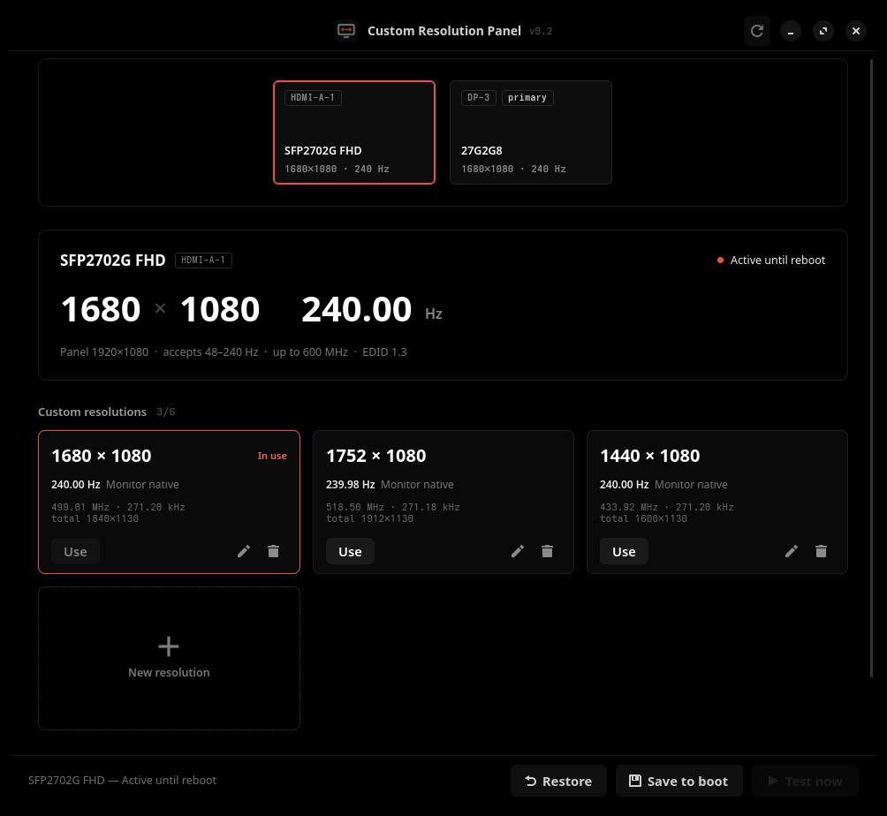

# Custom Resolution Panel

**Custom resolutions and refresh rates for Linux on Wayland** — GNOME, KDE Plasma,
Hyprland and Sway. A graphical alternative to the NVIDIA Control Panel "Customize"
button and to CRU (Custom Resolution Utility), which only exist on Windows.



On Wayland you can't add a mode with `xrandr --newmode` anymore, `nvidia-settings`
can't create resolutions, and GNOME has no setting for it at all (from GNOME 50 on there
isn't even an X11 session to fall back to). Custom Resolution Panel solves this at the
kernel level: it builds an EDID that contains the modes you want and makes the monitor
"advertise" them. Your desktop then sees them as regular modes, so they show up
everywhere: in display settings, in games and in screen recorders.

Typical uses:

- **Stretched resolutions for games** such as 1440×1080, 1280×960 or 1680×1080 at
  144/240 Hz, the classic competitive CS2 setup.
- **Refresh rates your monitor supports but doesn't advertise**, for example 75 Hz on
  a 60 Hz panel, 165 Hz or 200 Hz modes, or slight monitor overclocking.
- **Fixing missing resolutions** when the monitor's EDID is incomplete.

## Features

- Up to 6 custom resolutions per monitor: width, height and refresh rate.
- Timing calculated from the monitor's own blanking (like CRU's "LCD native"),
  CVT-RB2 or CVT-RB, with manual control over porches, sync and pixel clock.
- Warnings when a mode goes beyond the limits the monitor declares, or uses a width
  that some monitor scalers can't handle.
- **Test now**: applies immediately, no reboot and no changes to your boot setup.
- **Use**: switches to the resolution and reverts by itself after 15 s unless you
  confirm it, like on Windows.
- **Save to boot**: makes it permanent via `drm.edid_firmware` in GRUB, with a backup.
  It also installs a small systemd service that re-detects the monitors after each boot
  (what **Test now** does), because without it NVIDIA accepts the modes but shows black
  bars instead of stretching.
- **Restore**: brings back the monitor's original EDID.

## Desktop support

Creating the modes happens in the kernel, so it works everywhere. Switching to them
from inside the app needs to talk to your compositor:

| Desktop | Create modes, Test now, Save to boot | Layout map and **Use** button | Notes |
|---|---|---|---|
| **GNOME** (Mutter) | ✅ | ✅ D-Bus API | Tested on GNOME 50 |
| **KDE Plasma** | ✅ | ✅ `kscreen-doctor` | Plasma 6.6+ also has its own custom modes |
| **Hyprland** | ✅ | ✅ `hyprctl` | Shows the `monitor =` line to add to your config |
| **Sway** | ✅ | ✅ `swaymsg` | Shows the `output` line to add to your config |
| Other Wayland compositors | ✅ | — | Pick the new mode in your compositor's settings |

Only GNOME has been tested on real hardware so far. The KDE, Hyprland and Sway
integrations were checked against the output formats of their current releases. If
you use one of them, please open an issue to report whether it works.

On desktops other than GNOME and KDE, make sure a polkit authentication agent is
running, otherwise `pkexec` can't ask for your password.

## How it works

1. The app reads the monitor's EDID and appends an extra CTA-861 extension block with
   your modes. The rest of the EDID (vendor, serial number, FreeSync, range limits) is
   left untouched, so your desktop still recognises the monitor and keeps its settings.
2. **Test now** writes the new EDID to
   `/sys/kernel/debug/dri/*/<connector>/edid_override`, re-probes the connector and
   sends a hotplug event so the compositor picks it up.
3. **Save to boot** copies the file to `/usr/lib/firmware/edid/` and adds
   `drm.edid_firmware=` to `/etc/default/grub`.

Everything that needs root lives in a small separate helper started through `pkexec`.
It receives the EDID as hex, never a file path, validates it, runs with a fixed `PATH`,
and is installed in a root-owned location so no user process can replace the code that
runs as root.

## Requirements

- A Wayland session (see the table above).
- Python 3, GTK 4, libadwaita 1.6+ and PyGObject.
- polkit (`pkexec`) and debugfs mounted (the default on most distributions).
- GRUB, for **Save to boot**. **Test now** works with any bootloader.

| Distribution | Dependencies |
|---|---|
| Arch / Manjaro / CachyOS / EndeavourOS | `sudo pacman -S python-gobject gtk4 libadwaita` |
| Fedora | `sudo dnf install python3-gobject gtk4 libadwaita` |
| Debian / Ubuntu | `sudo apt install python3-gi gir1.2-gtk-4.0 gir1.2-adw-1` |

### GPU drivers

It works with any driver that honours the DRM EDID override. Tested with the
**NVIDIA 610 driver** (open kernel modules, RTX 2060 SUPER): `nvidia-drm` hands the
override EDID to the driver, and NVIDIA's parser reads modes from more than one CTA
block. **AMD (`amdgpu`)**, **Intel (`i915`/`xe`)** and `nouveau` use the same generic
kernel mechanism but have not been tested yet. Reports are welcome.

## Installation

```sh
git clone https://github.com/Wellfz/custom-resolution-panel.git
cd custom-resolution-panel
sudo ./install.sh
```

Then open **Custom Resolution Panel** from your app menu, or run
`custom-resolution-panel`.

To update, run `git pull` in the same folder followed by `sudo ./install.sh`.

To uninstall, click **Restore** on every monitor first, then run:

```sh
sudo ./install.sh --remove
```

## Tips and limitations

- **Resolutions below native look slightly soft.** The monitor's scaler stretches the
  image; there is no "perform scaling on GPU" option like on Windows. Whether the image
  is stretched or gets black bars depends on the aspect ratio setting in your monitor's
  menu.
- **Prefer widths that are a multiple of 16** (1440, 1680, 1760…). Some monitor scalers
  can't handle unusual widths and show a broken or black picture.
- If the monitor shows "out of range", just wait: the previous mode comes back in 15 s.
- If the picture doesn't come back, reboot — live tests don't survive a reboot. If you
  had saved to boot, remove `drm.edid_firmware=...` from the kernel command line in the
  GRUB menu (press `e`).
- **Save to boot** has been tested with GRUB on Arch-based distributions. On Fedora it
  regenerates `grub2.cfg`, but distributions that manage kernel arguments differently
  (BLS/`grubby`, systemd-boot) are not supported yet.
- EDIDs that use HF-EEODB (some HDMI 2.1 TVs) are not supported yet.

## FAQ

**Is this an xrandr `--newmode` / `--addmode` replacement for Wayland?**
Yes. Those commands only work on X11. This app makes the mode part of the monitor's
EDID, which every Wayland compositor reads.

**Is it a CRU (Custom Resolution Utility) for Linux?**
In spirit, yes: it edits the EDID like CRU does, but applies it through the Linux
kernel instead of the Windows registry.

**Can it damage my monitor?**
The monitor validates the signal itself and shows "out of range" when it can't display
a mode; the app reverts automatically after 15 s. As with CRU, pushing refresh rates
far beyond the monitor's specification is at your own risk.

## License

[GPL-3.0-or-later](LICENSE)
